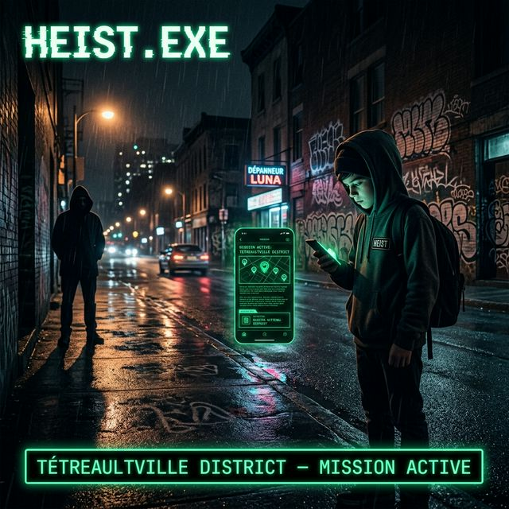
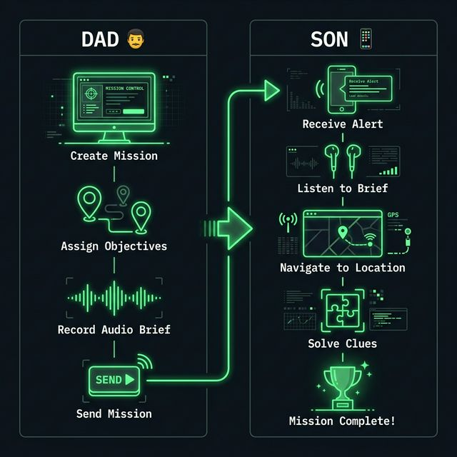
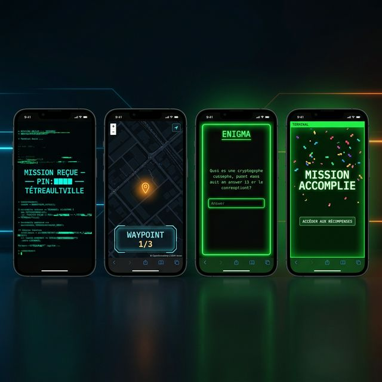

<div align="center">



<br/>

[](https://github.com/portefolio/heist_exe/releases/tag/v1.0.0)
[](https://fastapi.tiangolo.com)
[](https://react.dev)
[](#)
[](https://docker.com)
[](#)
[](https://openstreetmap.org)
[](#)
[](CHANGELOG.md)
[](LICENSE)
[](https://cotcollective.github.io/heist_exe/)

<br/>

### *Transforme ton quartier en mission d'espionnage.*
### *Papa crée. Le fils joue. Montréal ne sera plus jamais pareil.*

<br/>

```
╔════════════════════════════════════════════╗
║  > CONNEXION SÉCURISÉE ÉTABLIE            ║
║  > AGENT IDENTIFIÉ : TÉTREAULTVILLE       ║
║  > OBJECTIFS CHARGÉS : 3 waypoints        ║
║  > MESSAGE AUDIO : CHIFFRÉ               ║
║  > DURÉE DE MISSION : 45:00 ██████░░░░   ║
║  > STATUT : EN ATTENTE DE TON PREMIER PAS ║
╚════════════════════════════════════════════╝
```

</div>

---

## 🕹️ Keskon fait ici ?

**HEIST.EXE** est une plateforme de **jeu d'aventure urbaine** conçue pour être jouée dans les vraies rues.

**C'est simple :** Papa ouvre le panneau admin depuis son ordi, crée une mission secrète avec des waypoints GPS, des énigmes et un message vocal crypté. Il envoie un lien + PIN à son fils. Le fils installe l'app sur son cell (PWA = pas de store, pas de compte), et part en mission dans le quartier.

> *Ça ressemble à un jeu vidéo. Ça se joue dans la vraie vie.*

---

## 🎬 Comment ça marche

<div align="center">



</div>

| Étape | Papa 👨 | Fils 📱 |
|-------|---------|---------|
| 1 | Ouvre `http://localhost/admin` | — |
| 2 | Entre la clé admin (`ADMIN_KEY`) | — |
| 3 | Crée la mission : lore, waypoints GPS, énigmes, audio | — |
| 4 | Envoie lien + PIN 📲 | Reçoit le lien |
| 5 | — | Entre le PIN → **Briefing crypté** 🔐 |
| 6 | — | Écoute le message audio 🎧 |
| 7 | — | Suit la carte OpenStreetMap 🗺️ |
| 8 | — | Trouve le point → résout l'énigme 🧩 |
| 9 | — | **MISSION ACCOMPLIE** → Récompense 🏆 |

---

## 📱 L'app en action

<div align="center">



*Boot → Map GPS → Énigme → Victoire*

</div>

---

## 🌆 Mission démo incluse — Tétreaultville, Montréal

Lance `make seed` et une mission complète est déjà injectée et prête à jouer :

```
> MISSION : "L'agent X a été compromis. La clé est cachée près de l'eau."
> PIN     : 2077
> DURÉE   : 45 minutes
```

| # | Waypoint | Coordonnées | Énigme |
|---|----------|-------------|--------|
| 0 | 🌳 Parc L.-O.-Taillon | `45.568, -73.550` | *Lattes × numéro civique de la bâtisse rouge* |
| 1 | 🎨 Mural Hochelaga | `45.569, -73.548` | *Combien de couleurs dans le mural ?* |
| 2 | 🏁 Dépanneur Taillon | `45.570, -73.547` | *La planque finale. Tu mérites les chips.* |

---

## 🗺️ Le Monde — caches publiques

Une mission est une **séquence** ordonnée. Une cache du monde est un **lieu** : un waypoint orphelin (`mission_id = NULL`), public, réclamable indépendamment par plusieurs joueurs.

Même table, même géométrie, même preuve. Seul le **régime de réclamation** change.

| Régime | `claim_mode` | Portée |
|--------|--------------|--------|
| Progression de mission | `progress` | un joueur, une fois — avance la séquence |
| Trouvaille du monde | `find` | N joueurs, chacun une fois — permanente |

Une seule contrainte SQL (`UNIQUE(waypoint_id, player_name)`) sert les deux.

### Endpoints

```bash
# Catalogue public — ne renvoie JAMAIS qr_code, seulement requires_proof
GET  /world/caches?lat_min=45.5&lat_max=45.6&lng_min=-73.6&lng_max=-73.5

# Planter une cache orpheline (admin)
POST /world/caches

# Réclamer — preuve QR exigée si la cache en porte une
POST /world/caches/{id}/claim
     { "player_name": "Sam", "proof": "HEIST-CACHE-001" }

# Verser des caches au monde, IDEMPOTENT (admin)
POST /world/publish
     { "items": [ { "mission_id": 1, "waypoint_id": 4,
                    "title": "...", "lat": 45.5681, "lng": -73.5501,
                    "radius_meters": 120, "qr_code": "QR-001" } ] }
```

Le versement **copie**, il ne déplace pas. Le waypoint d'origine reste dans sa mission, intact : une mission en cours ne doit pas se retrouver amputée parce qu'on a versé ses caches au monde. La copie publique et le waypoint de mission sont deux objets distincts, avec deux régimes de réclamation différents.

Le versement est idempotent sur `(origin_mission_id, origin_waypoint_id)` : rejouer un lot renvoie les caches existantes avec `created: false` au lieu d'en créer des doublons. C'est ce qui rend une **file de retry** possible — une mission jouée hors ligne peut être synchronisée plus tard, deux fois, ou après une coupure.

**C'est aussi le mécanisme d'ensemencement** : une mission qui finit laisse ses caches derrière elle, et le monde grossit comme sous-produit des cadeaux.

### Migrations

`backend/migrations/*.sql`, appliqués au démarrage, versionnés dans `schema_version`. Aucune dépendance, aucun Alembic.

```bash
# Ajouter une migration
backend/migrations/002_ma_feature.sql
```

`init_db` crée d'abord les tables absentes (`create_all` ne touche jamais aux colonnes d'une table existante), puis applique les fichiers non encore vus. Une base neuve est **baselinée** : son schéma sort déjà complet de `create_all`, on marque les migrations comme appliquées sans les rejouer.

La migration `001_world` reconstruit `waypoints` — SQLite ne sait pas relâcher une contrainte `NOT NULL` par `ALTER`, il faut créer / copier / déposer / renommer. Les id sont préservés, donc les énigmes restent attachées.

### La règle de la carte

Le cercle est une **zone de recherche**, jamais une cible.

- Aucun marqueur au centre — on donne l'aire, pas le point.
- Distance affichée au **bord** de la zone, arrondie à 10 m.
- À l'entrée dans la zone, la distance **disparaît** complètement et devient `ZONE / CHERCHE`.

Un compteur au mètre près transforme le téléphone en détecteur de métaux : tu marches et tu regardes le chiffre descendre. Le gradient d'information doit s'effondrer exactement au moment où la recherche commence.

---

### Hors ligne

Le briefing propose de télécharger la carte de la zone avant de partir.

- Bornes calculées depuis les waypoints de la mission, + 400 m de marge.
- Zooms 14 → 17, **plafonné à 250 tuiles** par téléchargement.
- Les tuiles vont dans le cache `osm-tiles` — celui-là même que sert le service worker en `CacheFirst`. Relancer un téléchargement saute ce qui est déjà là.
- Les tuiles déjà là ne sont jamais re-téléchargées : le bouton est ré-exécutable sans coût.

Le plafond n'est pas de la timidité : la politique d'usage des tuiles OSM interdit les téléchargements massifs. Une zone de mission typique (quatre waypoints, ~1,5 km de côté) fait 60 à 120 tuiles, soit 1 à 2 Mo — largement sous le budget. Pour couvrir une ville entière il faudra une source tuilée dédiée (PMTiles auto-hébergé), pas les tuiles publiques.

**Important** : la couche Leaflet utilise un hôte unique `tile.openstreetmap.org`, sans sous-domaine `{s}`. La clé de cache est l'URL exacte ; si la carte demande `a.tile...` et le prefetch télécharge `tile...`, le cache ne sert à rien.

---

### Réclamation

Réclamer une cache demande une **clé d'appareil**. Pas de compte : l'app génère une paire ECDSA P-256 au premier usage, enregistre la publique, et signe chaque réclamation.

```bash
# 1. Enregistrer la clé publique (JWK) sous un nom d'agent
POST /world/agents
     { "player_name": "Sam", "public_jwk": { "kty":"EC","crv":"P-256","x":"…","y":"…" } }

# 2. Réclamer avec une signature de « waypoint_id|player_name|ts »
POST /world/caches/{id}/claim
     { "player_name": "Sam", "proof": "QR-001",
       "ts": 1792865709, "signature": "…" }   # base64url, 64 octets r‖s
```

Un nom appartient à sa clé : re-enregistrer « Sam » avec une autre clé renvoie **409**. C'est ce qui empêche de réclamer une identité existante.

La signature couvre le `waypoint_id` : une signature valide pour une cache ne vaut pas pour une autre. Fenêtre de validité 600 s — assez large pour un téléphone qui retrouve le réseau après coup.

WebCrypto produit une signature brute `r‖s` de 64 octets, `cryptography` attend du DER : la conversion est faite côté serveur (`app/agentkeys.py`). C'est le genre d'écart qui passe les tests unitaires et casse en production, donc il est vérifié en navigateur contre le vrai serveur.

> ⚠️ `crypto.subtle` n'existe qu'en contexte sécurisé : HTTPS ou localhost. Servir l'app en `http://` sur une IP de LAN fait échouer la signature — le message d'erreur le dit explicitement.

---

## ⚡ Démarrer en 60 secondes

```bash
# 1. Nettoyer tout dossier précédent   ->si le dossier existe deja
rm -rf heist_exe

# 2. Cloner + configurer
git clone https://github.com/cotcollective/heist_exe
cd heist_exe
cp .env.example .env      # édite ADMIN_KEY

# 3. Lancer (Docker requis)
docker-compose up --build -d

# 4. Injecter la mission démo Tétreaultville
# Attend que le backend soit "Healthy", puis :
make seed
```

### 🎭 Qui va où ?

| 🌐 URL | 👤 Pour qui | Description |
|--------|-------------|-------------|
| `http://localhost:8080` | � **LE FILS (l'Agent)** | Écran de mission, GPS, énigmes. Installez comme PWA sur son cell. |
| `http://localhost:8080/admin` | 👨 **PAPA (le Coordinateur)** | Créer/gérer les missions. Accessible aussi via le lien en bas de la page d'accueil. |
| `http://localhost:8080/api/docs` | 🔧 Développeur | Swagger auto-généré |
| `http://localhost:8080/world` | 🌍 **Tout le monde** | Carte publique des caches. Aucune authentification. |

> 🛡️ **Pour Papa** : L'écran d'accueil affiche un lien discret `// accès coordinateur` en bas — ou tape directement `/admin`. Le mot de passe = `ADMIN_KEY` dans ton `.env`.

---

## 📡 Donner accès au fils depuis son cell

Papa fait tourner le serveur sur son ordi. Le fils joue depuis son téléphone.

**Une seule commande :**

```bash
# L'app doit tourner (make up), puis :
make share
```

`make share` crée un **lien public temporaire** et affiche les instructions directement dans le terminal :

```
  ==================================================
  🎮 HEIST.EXE — PARTAGER AVEC LE FILS
  ==================================================

  ✅ Une fois l'URL affichée :
     1. Copie l'URL https://...
     2. Envoie-la par SMS au fils
     3. Il l'ouvre sur son cell → mission active !

  your url is: https://xyz.loca.lt   ← COPIER ÇA
```

> 💡 Fonctionne depuis **n'importe où** (même WiFi, data mobile, 4G...). Aucune installation requise.  
> `Ctrl+C` pour fermer le tunnel à la fin de la mission.

---

## 🛠️ Stack — 100% open source, zéro cloud

| | Tech | Pourquoi |
|-|------|----------|
| � | **FastAPI 0.115** + aiosqlite | Async natif, légèreté maximale |
| ⚛️ | **React 18** + Vite 5 | PWA mobile-first, build optimisé |
| 🗺️ | **Leaflet** + OpenStreetMap | Zéro API key, offline-capable |
| 🔐 | **JWT PIN-based** + bcrypt | Simple côté joueur, robuste côté data |
| 📡 | **WebSocket** | Countdown en temps réel |
| 🎧 | **Howler.js** | Briefing audio immersif |
| 📷 | **html5-qrcode** | Scanner QR intégré sans native |
| 🗄️ | **SQLite** | Une DB locale, pas de serveur, sauvegarde = 1 fichier |
| 🚀 | **Docker + Nginx** | Un `docker-compose up` = tout est live |

---

## 📁 Structure du projet

```
heist_exe/
├── 🐳 docker-compose.yml       Orchestration complète (backend + frontend + nginx)
├── ⚙️  Makefile                 Raccourcis dev
├── 🌐 nginx/nginx.conf          Proxy API + PWA + media
│
├── 🐍 backend/
│   ├── app/
│   │   ├── main.py             Entrypoint + CORS + lifespan
│   │   ├── models.py           Mission · Waypoint · Enigma · PlayerSession
│   │   ├── auth.py             JWT PIN-based + bcrypt
│   │   ├── ws.py               WebSocket countdown live
│   │   └── routes/             admin · missions · waypoints · enigmas · media
│   ├── seed.py                 Mission Tétreaultville prête à l'emploi
│   └── tests/                  22 tests pytest-asyncio (DB in-memory SQLite)
│
├── ⚛️  frontend/
│   └── src/
│       ├── pages/              Boot → Briefing → Map → Énigme → Récompense
│       ├── pages/admin/        Login · Dashboard · MissionBuilder 3 étapes
│       └── components/         GlitchText · Countdown · QRScanner · Map
│
├── 🎭 e2e/                     Playwright — mobile Chrome + Safari
│   ├── boot.spec.js            Auth joueur
│   ├── gameplay.spec.js        Game loop complet
│   ├── admin.spec.js           Mission builder
│   └── pwa.spec.js             PWA offline + manifest
│
└── 📸 assets/                  Visuels README
```

---

## 🧪 Commandes

```bash
# Docker (stack complète)
make up              # 🚀 Lancer tout
make down            # ⛔ Arrêter
make logs            # 📋 Logs en live
make seed            # 🌱 Mission Tétreaultville

# Tests backend (pytest)
make test            # 22 tests — DB in-memory, rapide

# Dev sans Docker
make dev-backend     # Backend local port 8000
make dev-frontend    # Vite dev server port 5173

# Tests E2E Playwright
npm install && npx playwright install chromium
npx playwright test              # Tous les tests
npx playwright test --ui         # Mode visuel interactif
```

---

## 🔑 Variables d'environnement

```env
SECRET_KEY=...                   # Clé JWT — min 32 chars
ADMIN_KEY=...                    # Clé API admin — garde ça secret !
DB_PATH=/app/data/heist.db       # SQLite (persisté en volume Docker)
MEDIA_PATH=/app/media            # Fichiers audio missionsACCESS_TOKEN_EXPIRE_HOURS=12
CORS_ORIGINS=http://localhost,http://localhost:5173
```

> ⚠️ **Aucune valeur par défaut n'existe plus.** Sans `ADMIN_KEY`, l'administration répond `503` — elle ne s'ouvre plus avec `admin-secret-key`. Sans `SECRET_KEY`, une clé éphémère est générée au démarrage : les jetons joueur ne survivent pas à un redémarrage, mais ils ne peuvent pas être forgés.
>
> Les deux sont relues **à chaque requête** : changer `ADMIN_KEY` prend effet sans redémarrer le process. Génère des valeurs avec `python3 -c "import secrets; print(secrets.token_hex(32))"`.

---

## 🚀 Créer une mission via l'API

```bash
curl -X POST http://localhost/api/admin/missions \
  -H "Authorization: Bearer <ADMIN_KEY>" \
  -H "Content-Type: application/json" \
  -d '{
    "title": "Opération Bravo",
    "lore": "Un colis a été abandonné près du fleuve...",
    "pin": "1337",
    "duration_minutes": 30,
    "reward_text": "Glace au dépanneur du coin. Tu l'\''as mérité.",
    "waypoints": [
      {
        "order": 0,
        "title": "Point Alpha",
        "hint": "Là où le métal rencontre le béton.",
        "lat": 45.568,
        "lng": -73.550,
        "radius_meters": 30,
        "enigma": {
          "question": "Combien de marches mènent à la porte rouge ?",
          "answer": "7"
        }
      }
    ]
  }'

# Uploader un briefing audio
curl -X POST http://localhost/api/upload/audio/<mission_id> \
  -H "Authorization: Bearer <ADMIN_KEY>" \
  -F "file=@briefing.mp3"
```

---

<div align="center">

---

💬 Connect With Us / Contactez-Nous
🐙 GitHub: @cotcollective
📧 Issues & Questions: Open an issue on GitHub
🎮 don't forget to leave a ✨️!
👨‍💻 About the Creator
Dave Senez - Researcher & AI Developer

🔬 ORCID: https://orcid.org/0009-0005-3410-323X
📚 Pre-prints, Papers & AI Research Available on ORCID
🤖 Symbiotic AI Partner(s) - Building the future together
📧 For inquiries & job opportunities: D.SENEZ.RESEARCH@PROTON.ME

**Fait avec ☕ à Montréal · Tétreaultville District · 2025**

*Pour chaque père qui veut que son fils vive une vraie aventure.*

`v1.0` · MIT License · [Swagger docs]

</div>
